# Glyphstage

Classic text adventures, played with every room drawn as a live **3D ASCII scene**. Glyphstage
runs the original game file unmodified on its own Z-machine interpreter, and builds a picture
of each place from the game's own description as you walk in. The first title is **Zork I**
(Infocom, 1980), whose source Microsoft released under the MIT license in 2025.

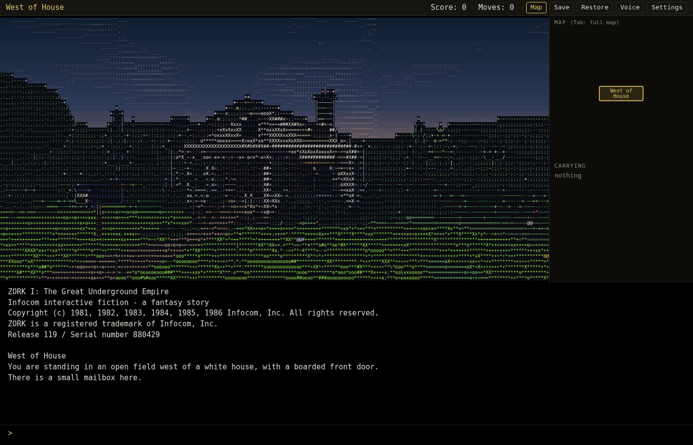

> **Showcase repository.** The source code for this project is private. This page covers what
> it does, how it's built and what it looks like.

Look closely and it's all text characters, shaded by depth and light:

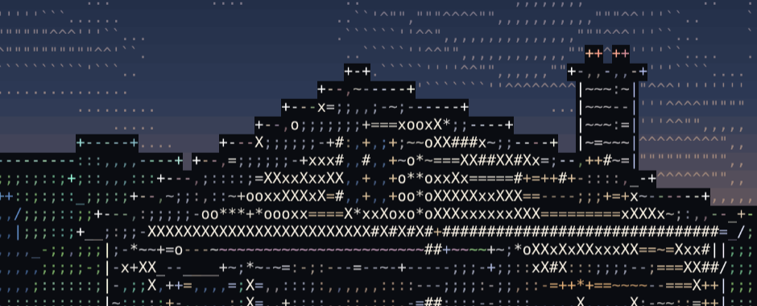

## Highlights

- **The real game underneath.** A Z-machine interpreter written for this project plays the
  original story file, so every puzzle, parser quirk and joke is exact. Zork II runs on it
  unchanged.
- **A scene for every room.** A generator reads each room's description and composes a 3D
  scene from a kit of parts: walls, doors and passages, furniture, trees, water, light. There
  are no hand-built scenes; when the generator needs help, a room gets small tuning overrides.
- **Scenes follow the game.** Exits are read from the story file, not guessed from text. In a
  dark room the view goes pitch black, then fades up when your lamp comes on, and the light
  follows the lamp's battery.
- **Auto-map** built from the moves you make, a live **inventory** read from the game's object
  tree, and **save slots** that keep the game and its map together
- **Looks and voice**: five render styles with palettes (including your own), an optional
  narrator voice, and per-room tuning in an advanced mode
- **Desktop app**: one Python process serves the page to a native window, and the renderer
  runs in a web worker at about 30 fps at its default 200 × 48 detail

## Screens

| | |
|:---:|:---:|
| 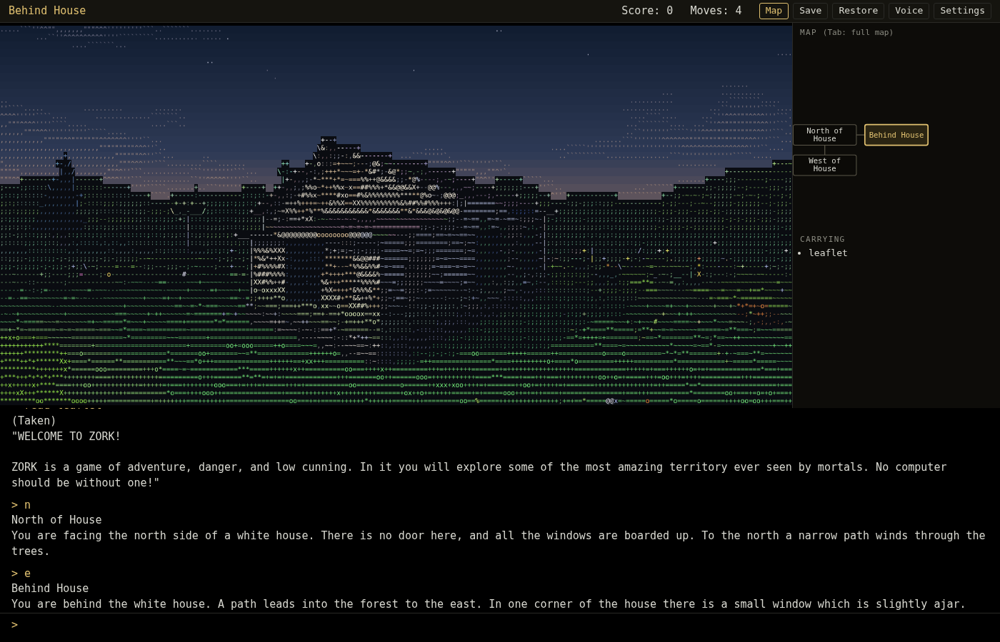 | 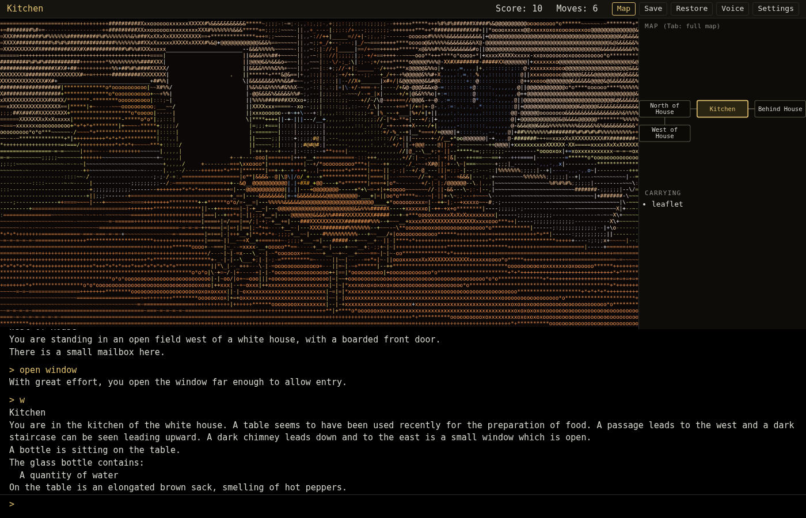 |
| **Behind House**: the small window is the way in | **Kitchen**: inside the white house |
| 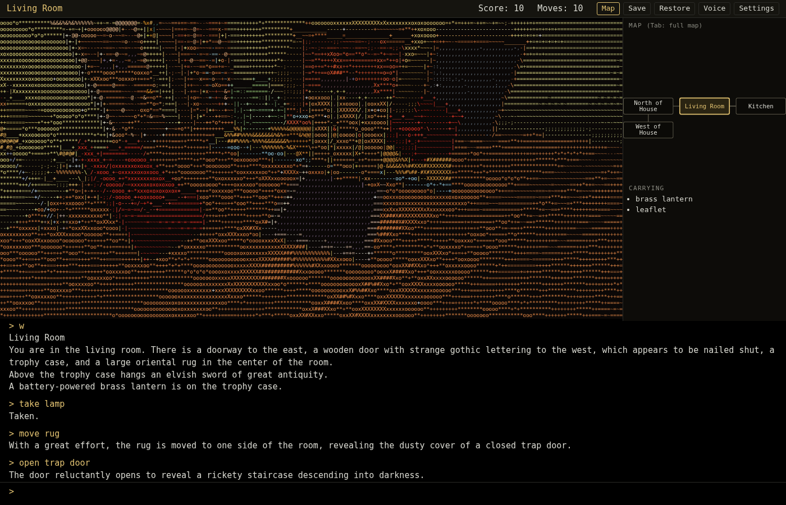 | 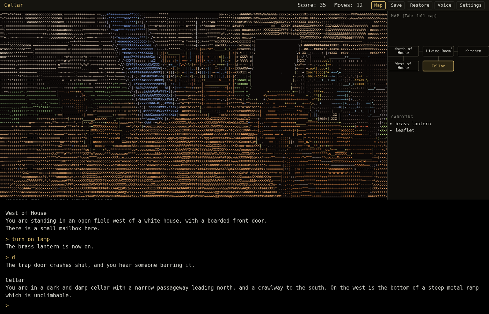 |
| **Living Room**: trophy case and the rug over the trap door | **Cellar**: lit by the brass lantern |
| 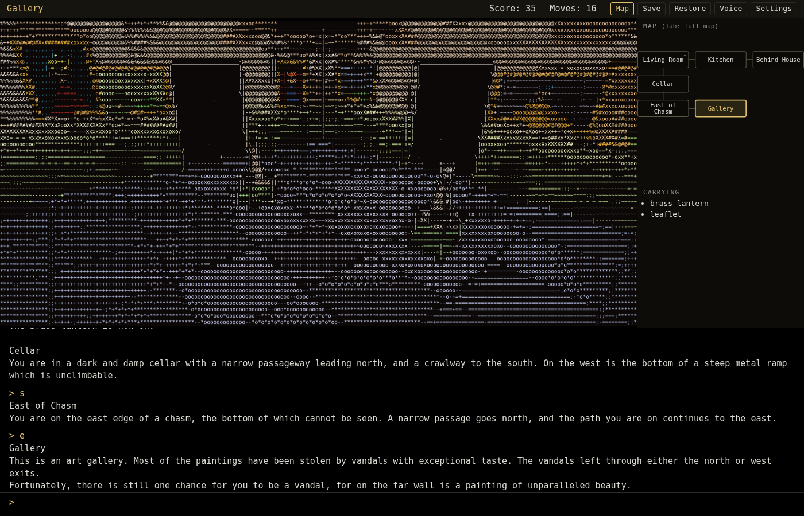 | 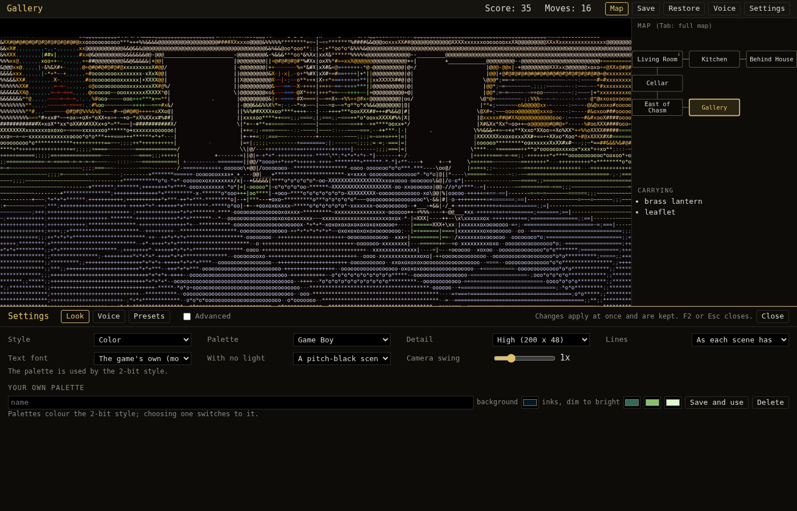 |
| **Gallery**: paintings on the walls | **Settings**: style, palette, detail, font and camera swing |

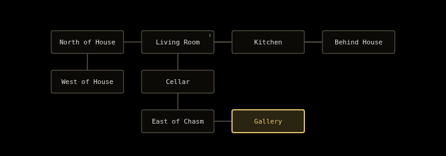

The full map (Tab) after the first few minutes of play.

## Render styles

| | | |
|:---:|:---:|:---:|
| 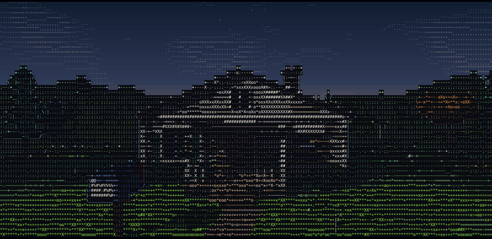 | 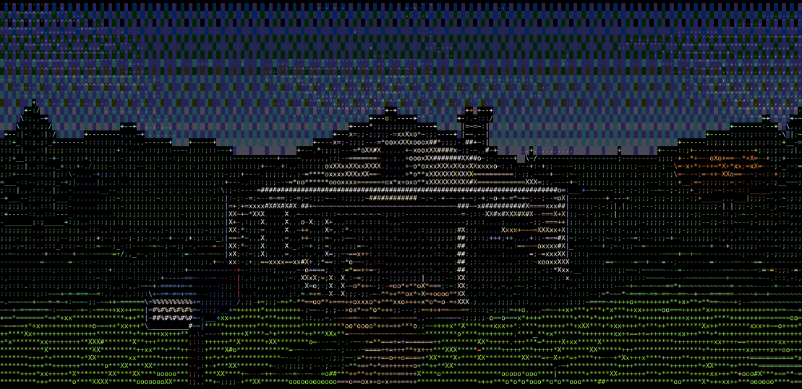 | 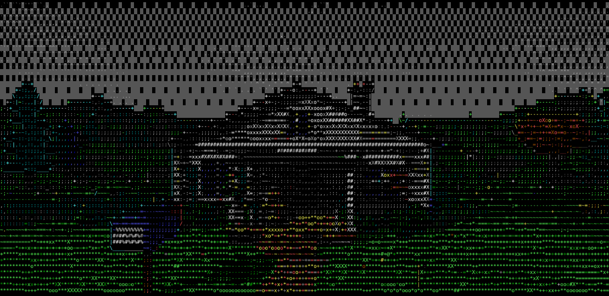 |
| **Color** | **8-bit** | **4-bit EGA** |
| 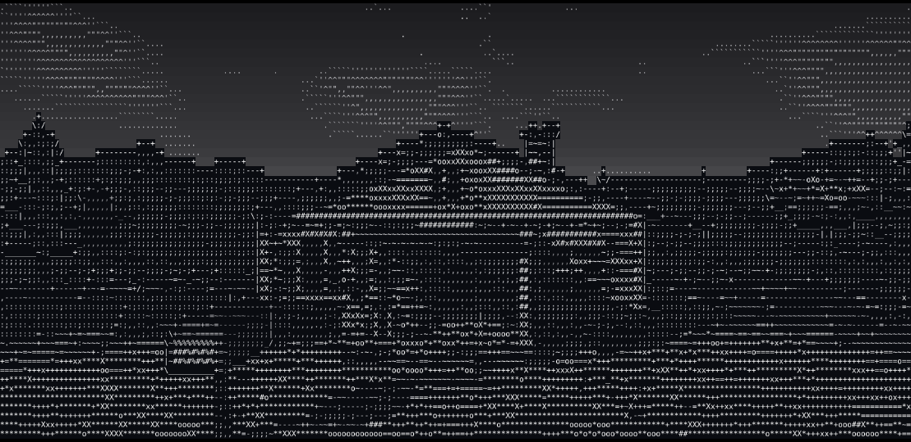 | 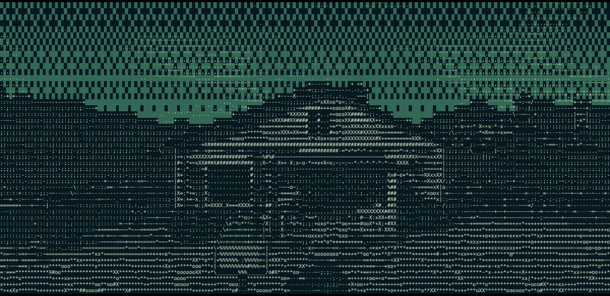 | 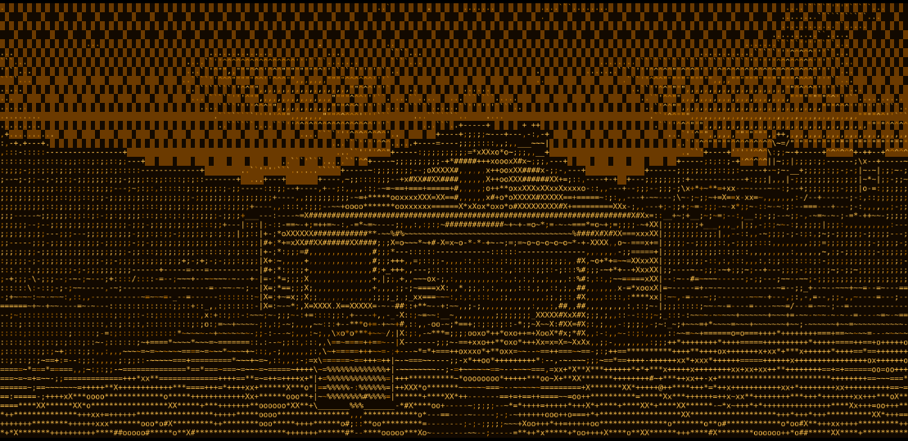 |
| **Granite** | **2-bit**, Game Boy palette | **2-bit**, Amber CRT palette |

## How it works

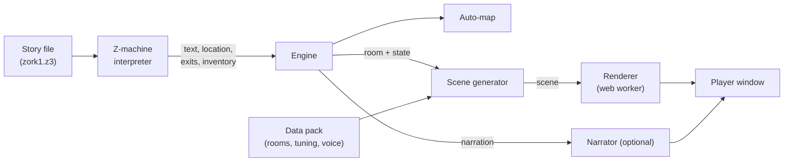

- The **engine** never reads game text directly. It talks to a backend interface (start, send a
  line, location, exits, inventory, status), so other story files and formats can plug in.
- A **data pack** holds everything game-specific: room text extracted at build time, scene
  tuning, voice lines and the legal notices, which the engine refuses to start without.
- Saves are treated as untrusted input: everything is validated before the running game is
  touched, and files are written atomically.
- Licensing is designed in from the start: no GPL code, our own interpreter and number-to-words
  code, and a license audit tool that tracks every third-party component.

## Status

In active development. The player window, scene generator, darkness, auto-map, save slots,
settings and narrator are working. The v1 goal is Zork I playable start to finish across all
110 rooms, as a desktop app on Linux, Windows and macOS.

---

Zork I source © Microsoft, released under the MIT license. ZORK is a registered trademark of
its owner. Glyphstage is an independent project and is not affiliated with or endorsed by the
trademark owner.
